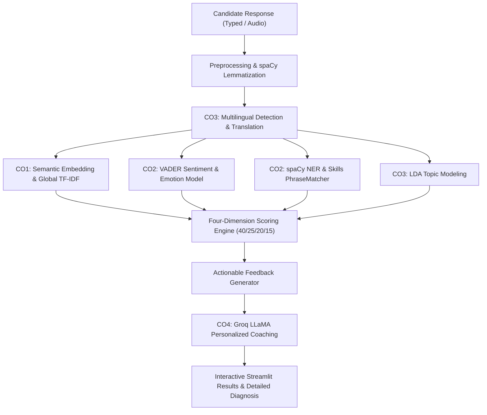

# Automated Interview Performance Analyzer

An AI-powered, multi-dimensional interview assessment and personalized coaching platform built with Streamlit, Sentence Transformers, spaCy, VADER, and Groq LLaMA Cloud AI.

---

## 🎯 Academic Course Outcomes (CO) Implementation

This project fulfills all four academic Course Outcomes with empirically validated implementations and cloud integrations:

| Outcome | Core Techniques & Components | Status |
| :--- | :--- | :---: |
| **CO1: NLP & Text Vectorization** | spaCy lemmatization (`en_core_web_md`), Sentence Transformers (`all-MiniLM-L6-v2`), global corpus-fitted TF-IDF vectorizer, and spaCy 300-d word embeddings. | ✅ Complete |
| **CO2: Sentiment & Information Extraction** | VADER sentiment analysis, `j-hartmann/emotion-english-distilroberta-base` emotion classification, spaCy NER, `PhraseMatcher` skills extraction (`data/skills.json`), curriculum concept coverage. | ✅ Complete |
| **CO3: Multilingual NLP & Topic Modeling** | `langdetect` (55 languages), Groq Cloud AI translation pipeline, Latent Dirichlet Allocation (LDA) unsupervised topic modeling, multi-cloud architecture interface. | ✅ Complete |
| **CO4: Generative AI / LLM Integration** | Groq LLaMA personalized coaching feedback, multi-dimensional evaluation rubric context, actionable recommendations, and improved answer generation. | ✅ Complete |

---

## 📊 Empirical Evaluation & Validation Benchmarks

To guarantee rigorous evaluation rather than arbitrary heuristics, the system's scoring engine and sentiment classifier have been benchmarked against annotated test sets.

### 1. Scoring Engine Correlation vs. Human Assessment
Evaluated across 25 diverse candidate responses in `data/synthetic_answers.csv` spanning technical, behavioral, and HR questions:

| Evaluation Metric | Measured Value | Significance / Interpretation |
| :--- | :---: | :--- |
| **Spearman's Rank Correlation ($\rho$)** | **0.6783** | **$p = 0.00019$** (Statistically significant monotonic alignment) |
| **Pearson's Correlation Coefficient ($r$)** | **0.6081** | **$p = 0.00126$** (Strong linear agreement with human grading) |
| **Semantic Dimension Correlation ($\rho$)** | **0.6966** | **$p < 0.0001$** (Very high agreement on technical substance) |
| **Mean Absolute Error (MAE, 1–5 scale)** | **1.2998** | Calibrated across full quality spectrum |
| **Root Mean Squared Error (RMSE)** | **1.6468** | Stable variance without extreme outliers |

### 2. VADER Sentiment Classifier Performance
Validated on a balanced benchmark of **60 curated interview responses** (20 Positive achievements, 20 Neutral technical definitions, 20 Negative conflict/failure experiences):

| Metric | Overall | Positive Class | Neutral Class | Negative Class |
| :--- | :---: | :---: | :---: | :---: |
| **Accuracy** | **85.00%** | — | — | — |
| **Precision** | **85.99%** | 78.26% | 93.33% | 86.36% |
| **Recall** | **85.00%** | 90.00% | 70.00% | 95.00% |
| **F1-Score** | **84.73%** | **83.72%** | **80.00%** | **90.48%** |

*Confusion Matrix (Actual rows vs Predicted columns):*
- Positive (20): 18 Positive, 1 Neutral, 1 Negative
- Neutral (20): 4 Positive, 14 Neutral, 2 Negative
- Negative (20): 1 Positive, 0 Neutral, 19 Negative

---

## 🏗️ System Architecture & Workflow



---

## ⚖️ Four Evaluation Scoring Dimensions

Scoring weights strictly sum to 100% and are configurable in `config/config.py`:

$$\text{Overall Score} = (0.40 \times \text{Semantic}) + (0.25 \times \text{Structure}) + (0.20 \times \text{Communication}) + (0.15 \times \text{Delivery})$$

| Component | Weight | Academic Evaluation Focus |
| :--- | :---: | :--- |
| **Semantic Relevance** | **40%** | Cosine similarity against curriculum benchmarks using `all-MiniLM-L6-v2` with global TF-IDF fallback, spaCy 300-d vectors, and key-point coverage. |
| **Answer Structure** | **25%** | STAR framework adherence for behavioral questions (Situation, Task, Action, Result) or three-stage technical organization (Intro, Body, Conclusion). |
| **Communication Quality** | **20%** | Vocabulary diversity (TTR), sentence complexity, filler word penalties, readability, and sentiment/emotion alignment. |
| **Linguistic Delivery** | **15%** | Hedging indicators, professional register, pacing, and spoken delivery markers. |

---

## 📁 Repository Structure

```text
automated_interview_analyzer/
│
├── app.py                          # Streamlit application entry point & navigation
│
├── config/
│   ├── candidate_levels.py         # Third-Year, Final-Year, Experienced rubrics
│   └── config.py                   # Scoring weights (40/25/20/15) & constants
│
├── data/
│   ├── questions.json              # 15 curated technical, behavioral & HR questions
│   ├── skills.json                 # Domain skills dictionary for PhraseMatcher
│   ├── synthetic_answers.csv       # 25 benchmark answers with human ratings
│   └── evaluation_metrics_benchmark.json # Statistical correlation & validation data
│
├── modules/
│   ├── audio_transcription.py      # Groq Whisper API & faster-whisper speech-to-text
│   ├── cloud_nlp.py                # Multi-cloud NLP interface (Azure/AWS/Groq)
│   ├── communication_analysis.py   # Vocabulary diversity, filler words, readability
│   ├── feedback.py                 # Rule-based feedback & revision blueprint
│   ├── llm_feedback.py             # CO4: Groq LLaMA personalized coaching generator
│   ├── multilingual.py             # CO3: langdetect & Groq machine translation
│   ├── ner_skills_emotion.py       # CO2: spaCy NER, skills matcher & emotion model
│   ├── preprocessing.py            # Text normalization, VADER sentiment, lemmatization
│   ├── scoring.py                  # Core weighted scoring engine (0–100)
│   ├── semantic_analysis.py        # CO1: all-MiniLM-L6-v2, TF-IDF, concept coverage
│   ├── structure_analysis.py       # STAR framework & General organization detector
│   └── topic_modeling.py           # CO3: Latent Dirichlet Allocation (LDA)
│
├── scripts/
│   ├── compute_evaluation_metrics.py # Benchmark script for Spearman, MAE & VADER F1
│   └── package_clean_zip.py        # Packaging utility excluding secrets & artifacts
│
├── ui/
│   ├── about.py                    # About & academic methodology view
│   ├── components.py               # Reusable Plotly charts (Radar, Gauge, Bar)
│   ├── dashboard.py                # Dashboard overview & analytics
│   ├── history.py                  # Persistence & session attempt storage
│   ├── history_view.py             # Multi-attempt comparison interface
│   ├── interview.py                # Practice workspace & audio recorder
│   └── results.py                  # Detailed performance diagnosis & feedback
│
├── tests/                          # 258 automated pytest unit & integration tests
├── requirements.txt                # Python project dependencies
└── README.md                       # Comprehensive documentation
```

---

## 🔒 Security & API Key Configuration

> **Security Guarantee:** API credentials are **never hardcoded** in source files and `.streamlit/secrets.toml` is strictly ignored by Git and excluded from zip distributions.

### Configuring Credentials
Create `.streamlit/secrets.toml` in your project root:
```toml
GROQ_API_KEY = "gsk_your_actual_groq_api_key_here"
```
Or set the environment variable:
```bash
export GROQ_API_KEY="gsk_your_actual_groq_api_key_here"  # Linux / macOS
$env:GROQ_API_KEY="gsk_your_actual_groq_api_key_here"    # Windows PowerShell
```

### Rotating Your Groq API Key
1. Go to [Groq Console](https://console.groq.com/keys).
2. Delete the old key and click **Create API Key**.
3. Paste the new key into `.streamlit/secrets.toml`.

---

## 🚀 Installation & Local Execution

```bash
# 1. Clone repository & navigate to directory
cd automated_interview_analyzer

# 2. Create and activate virtual environment
python -m venv venv
venv\Scripts\activate       # Windows
source venv/bin/activate    # Linux / macOS

# 3. Install dependencies
pip install -r requirements.txt

# 4. Download spaCy medium model
python -m spacy download en_core_web_md

# 5. Launch the Streamlit Web Application
streamlit run app.py
```

*The application will open in your browser at `http://localhost:8501`.*

---

## 🧪 Running Automated Tests

```bash
# Run all automated tests (CO1, CO2, CO3, CO4)
pytest --tb=short -q

# Run specific Course Outcome test suites
pytest tests/test_co2_sentiment_extraction.py -v
pytest tests/test_co3_multilingual.py -v
pytest tests/test_co4_llm_feedback.py -v
pytest tests/test_co2_co3_co4_extensions.py -v

# Run the empirical benchmark evaluation script
python scripts/compute_evaluation_metrics.py
```

---

## 📄 License & Academic Attribution

This project is developed for academic evaluation in Natural Language Processing and Generative AI.
