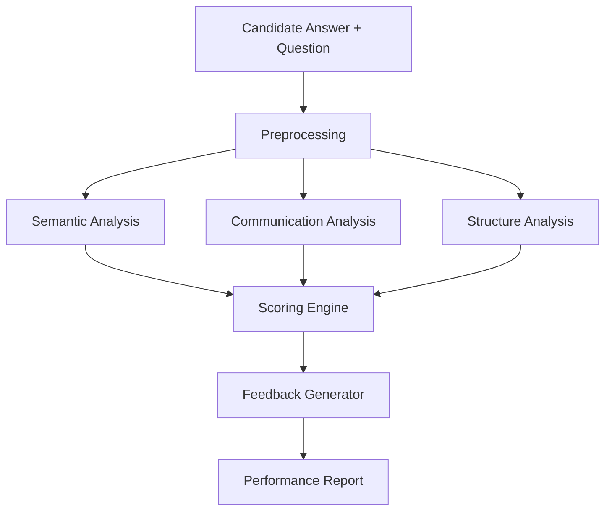

# Automated Interview Performance Analyzer

An AI-powered system that evaluates candidate interview responses across multiple dimensions — semantic relevance, communication quality, answer structure, and overall performance — and generates actionable feedback.

---

## Problem Statement

Interview evaluation is inherently subjective and inconsistent. Different interviewers may focus on different aspects of a candidate's answer, and fatigue, bias, or lack of calibration can lead to unfair assessments. There is a need for a **consistent, transparent, and multi-dimensional** analysis tool that can supplement human judgment with data-driven evaluation.

## Objectives

1. **Semantic Relevance Analysis** — Measure how well a candidate's answer addresses the interview question using NLP-based similarity and keyword coverage.
2. **Communication Quality Assessment** — Evaluate vocabulary richness, sentence complexity, filler word usage, and overall linguistic delivery.
3. **Structure & Organization Scoring** — Assess logical flow, paragraph structure, and adherence to frameworks like the STAR method for behavioral questions.
4. **Weighted Composite Scoring** — Combine all dimensions into a single configurable performance score.
5. **Actionable Feedback Generation** — Produce specific, constructive feedback with strengths, weaknesses, and improvement suggestions.

## Main Features (Planned)

| Feature | Status |
|---|---|
| Interview question dataset with reference answers | ✅ Complete (Part 1) |
| Synthetic development answer dataset | ✅ Complete (Part 1) |
| Configurable scoring weights | ✅ Complete (Part 1) |
| Data validation test suite | ✅ Complete (Part 1) |
| Text preprocessing pipeline | ✅ Complete (Part 2) |
| Communication quality metrics & delivery indicators | ✅ Complete (Part 2) |
| STAR method structure detection | ✅ Complete (Part 2) |
| Sentiment analysis (VADER) | ✅ Complete (Part 2) |
| Semantic similarity analysis (Sentence Transformers & TF-IDF) | ✅ Complete (Part 3) |
| Key-point & optional point coverage scoring | ✅ Complete (Part 3) |
| Technical correctness & misconception analysis | ✅ Complete (Part 3) |
| General organization & structure analysis | ✅ Complete (Part 3) |
| Weighted overall scoring engine (0 - 100) | ✅ Complete (Part 3) |
| Personalized & actionable feedback generator | ✅ Complete (Part 3) |
| Interactive Streamlit dashboard & visualizations | ✅ Complete (Part 4) |
| Session history persistence & multi-attempt comparison | ✅ Complete (Part 4) |

## Technology Stack

| Component | Technology |
|---|---|
| Language | Python 3.10+ |
| Data formats | JSON, CSV |
| Data handling | Pandas, NumPy |
| NLP | NLTK, sentence-transformers |
| Sentiment analysis | VADER |
| ML utilities | scikit-learn |
| Visualization | Plotly |
| Dashboard | Streamlit (Part 3) |
| Testing | pytest |

## Project Architecture



## Folder Structure

```text
automated_interview_analyzer/
│
├── app.py                          # Main application entry point
│
├── config/
│   └── config.py                   # Project configuration and scoring weights
│
├── data/
│   ├── interview_history.json      # Persistent session interview history
│   ├── questions.json              # Interview questions with reference answers
│   └── synthetic_answers.csv       # Synthetic development answer dataset
│
├── modules/
│   ├── __init__.py
│   ├── communication_analysis.py   # Communication quality metrics & delivery
│   ├── feedback.py                 # Actionable feedback & revision blueprint
│   ├── preprocessing.py            # Text cleaning, tokenization, VADER sentiment
│   ├── scoring.py                  # Weighted composite scoring engine
│   ├── semantic_analysis.py        # Semantic relevance, key-points & misconceptions
│   └── structure_analysis.py       # STAR and General Organization analysis
│
├── ui/
│   ├── __init__.py
│   ├── about.py                    # About Project & methodology page
│   ├── components.py               # Reusable Plotly charts and CSS cards
│   ├── dashboard.py                # Dashboard overview & analytics
│   ├── history.py                  # History storage and attempt comparison
│   ├── history_view.py             # History log & comparison interface
│   ├── interview.py                # Practice workspace & prompt evaluation
│   └── results.py                  # Detailed evaluation breakdown view
│
├── utils/
│   ├── __init__.py
│   └── helpers.py                  # Shared utility functions
│
├── tests/
│   ├── test_communication.py       # Communication & delivery tests
│   ├── test_data.py                # Data & configuration integrity tests
│   ├── test_feedback.py            # Feedback generator unit tests
│   ├── test_preprocessing.py       # Preprocessing & sentiment tests
│   ├── test_scoring.py             # Scoring bounds & weight tests
│   ├── test_semantic_analysis.py   # Semantic similarity & concept tests
│   ├── test_structure.py           # STAR detection tests
│   └── test_ui.py                  # UI components, history & Plotly tests
│
├── requirements.txt                # Python dependencies
└── README.md                       # This file
```

## Dataset Descriptions

### Interview Questions (`data/questions.json`)

Contains **15 interview questions** across three categories:

| Category | Count | Topics |
|---|---:|---|
| HR | 5 | Self-introduction, strengths, weaknesses, career goals, motivation |
| Behavioral | 5 | Teamwork, leadership, conflict resolution, deadlines, feedback |
| Technical | 5 | Python (lists vs tuples, decorators), SQL (JOINs), ML (overfitting, evaluation metrics) |

Each question includes a reference answer, expected keywords, key points, optional points, common misconceptions, and evaluation criteria.

### Synthetic Development Answers (`data/synthetic_answers.csv`)

Contains **25 synthetic candidate responses** spanning a full quality spectrum:

| Quality Level | Description |
|---|---|
| Excellent (5/5) | Comprehensive, well-structured, specific examples |
| Good (4/5) | Solid content with minor gaps |
| Average (3/5) | Basic understanding, lacking depth |
| Weak (2/5) | Vague, missing key concepts |
| Irrelevant/Poor (1/5) | Off-topic, misconceptions, or filler-heavy |

The dataset includes answers with filler words, incomplete STAR structure, and technical misconceptions to test edge cases.

> **⚠️ Important:** The ratings in `synthetic_answers.csv` are **synthetically generated for development and testing purposes**. They are approximate quality labels created to support system development and are **NOT genuine human expert assessments**. Do not treat these ratings as validated ground truth for model evaluation. A properly annotated evaluation dataset with real expert ratings should be created separately for production use.

## Scoring Weights

The composite score is a weighted combination of four analysis dimensions:

| Component | Weight |
|---|---:|
| Semantic relevance | 40% |
| Communication quality | 20% |
| Delivery indicators | 15% |
| Answer structure | 25% |

Weights are configurable in `config/config.py` and validated to ensure they sum to 100%.

## Installation

```bash
# Clone the repository
git clone <repository-url>
cd automated_interview_analyzer

# Create and activate a virtual environment (recommended)
python -m venv venv
source venv/bin/activate    # Linux/macOS
venv\Scripts\activate       # Windows

# Install dependencies
pip install -r requirements.txt
```

## Running the Project

### Data Validation

```bash
pytest tests/test_data.py -v
```

### Launching the Streamlit Web Application

```bash
streamlit run app.py
```

### CLI Demonstration Mode

```bash
python app.py
```

### Running All Automated Tests

```bash
pytest tests/ -v
```

## Implementation Status

- ✅ **Part 1 (Foundation):** Modular architecture, 15 interview questions, 25 synthetic answers, dynamic scoring configuration, data validation tests.
- ✅ **Part 2 (Preprocessing & Delivery):** Text normalization, boundary-safe filler detection, hedging analysis, vocabulary diversity, VADER sentiment, heuristic STAR structure detection.
- ✅ **Part 3 (Scoring & Feedback):** Sentence Transformers & TF-IDF similarity, key-point conceptual coverage, technical misconception detection, explainable 0–100 weighted scoring, actionable feedback generation, experimental Ridge Regression.
- ✅ **Part 4 (Dashboard & Integration):** Complete Streamlit web application, Plotly interactive radar/bar/gauge charts, persistent interview history (`interview_history.json`), cross-attempt comparison, academic evaluation methodology. All 104 unit tests passing.

## Limitations

1. **Synthetic data only** — All development ratings are AI-generated approximations, not expert annotations.
2. **No NLP models loaded** — Sentence transformers and NLTK data are not downloaded in this stage.
3. **No scoring logic** — Module files are placeholders; the analysis engine is not yet implemented.
4. **English only** — The system is designed for English-language interviews.
5. **Limited question set** — 15 questions cover common interview topics but do not represent all possible interview domains.

## License

This project is for educational and development purposes.

